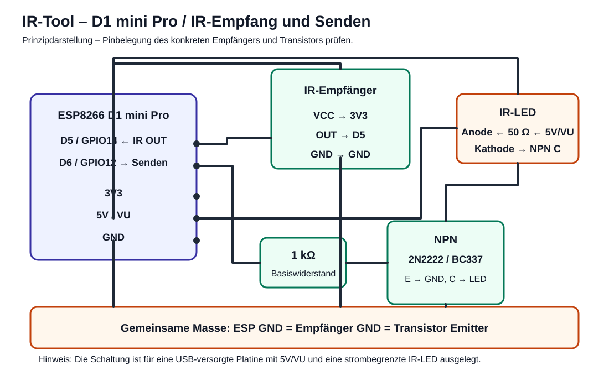

# IR-Tool

Komplettes ESP8266-Projekt zum Aufnehmen, dauerhaften Speichern und Senden von Infrarot-Signalen über ein mobiles Webinterface.

## Projektstand

Das Projekt ist für einen **LOLIN/WEMOS D1 mini Pro (ESP8266)** ausgelegt.

| Funktion | Umsetzung |
|---|---|
| IR-Empfang | `D5` / GPIO14 |
| IR-Senden | `D6` / GPIO12 über Transistor |
| Webinterface | eigenes WLAN `ESP-IR`, `192.168.4.1` |
| Speicher | LittleFS, 5 Slots |
| Protokolle | Samsung, Samsung36, Epson, Raw-Fallback |
| Haltefunktion | Signal wird beim Senden ca. 2 Sekunden wiederholt |
| Bedienung | große Touch-Flächen, für kleine Displays geeignet |

## Dateien

- [`esp_ir_webinterface.ino`](esp_ir_webinterface.ino) – Firmware
- [`docs/VERDRAHTUNG.md`](docs/VERDRAHTUNG.md) – Anschlüsse und Aufbau
- [`docs/schematic.svg`](docs/schematic.svg) – grafischer Schaltplan
- [`docs/TESTPLAN.md`](docs/TESTPLAN.md) – Inbetriebnahme und Funktionstest

## Benötigte Bauteile

- ESP8266 D1 mini Pro
- 38-kHz-IR-Empfänger, z. B. VS1838B oder TSOP38238
- 940-nm-IR-LED
- NPN-Transistor, z. B. 2N2222, BC337 oder kompatibel
- 1-kΩ-Widerstand für die Transistorbasis
- 50-Ω-Widerstand für die IR-LED (nur mit dafür ausgelegter IR-LED und passendem Transistor)
- Steckbrett und Jumperkabel
- USB-Datenkabel

Der Empfänger muss mit 3,3 V kompatibel sein. Die Pin-Reihenfolge von IR-Empfängern unterscheidet sich je nach Hersteller; vor dem Anschließen das Datenblatt prüfen.

## Schaltung



Die IR-LED wird nicht direkt am ESP8266-GPIO betrieben. Der GPIO steuert nur die Transistorbasis. Die LED bekommt ihren Strom über einen 50-Ω-Vorwiderstand. Bei 5 V können dabei ungefähr 70–75 mA Impulsstrom entstehen. Das ist nur zulässig, wenn Datenblatt und Transistor diesen Pulsstrom erlauben. Alle GND-Anschlüsse müssen verbunden sein.

Eine ausführliche Tabelle mit den Anschlüssen steht in [`docs/VERDRAHTUNG.md`](docs/VERDRAHTUNG.md).

## Installation mit Arduino IDE

1. ESP8266-Boardverwalter installieren.
2. Bibliothek `IRremoteESP8266` installieren.
3. `esp_ir_webinterface.ino` öffnen.
4. Board `LOLIN(WEMOS) D1 mini Pro` auswählen. Falls es nicht angezeigt wird, `LOLIN(WEMOS) D1 mini` verwenden.
5. Den richtigen COM-Port auswählen.
6. Sketch kompilieren und hochladen.

Die Firmware verwendet LittleFS. Falls die verwendete ESP8266-Core-Version nach einem Dateisystem-Upload fragt, `LittleFS` auswählen.

## Bedienung

1. Mit dem WLAN **ESP-IR** verbinden.
2. Passwort: **12345678**.
3. Im Browser `http://192.168.4.1` öffnen.
4. Einen Speicherplatz auswählen.
5. **IR-Signal aufnehmen** drücken und eine Fernbedienungstaste betätigen.
6. Protokoll, Frequenz und Impulsanzahl prüfen.
7. **Signal dauerhaft speichern** drücken.
8. Mit **Gespeichertes Signal senden** wird das Signal etwa zwei Sekunden lang wiederholt – ähnlich wie eine gehaltene Taste.

## Einstellungen im Code

Die wichtigsten Einstellungen stehen am Anfang von `esp_ir_webinterface.ino`:

| Konstante | Standardwert | Änderung |
|---|---:|---|
| `SEND_DURATION_MS` | `2000` | Sendedauer in Millisekunden; `5000` ergibt ca. 5 Sekunden |
| `SEND_GAP_MS` | `35` | Pause zwischen zwei IR-Rahmen in Millisekunden |
| `SLOT_COUNT` | `5` | Anzahl der Speicherplätze; das Webinterface zeigt aktuell 5 Tasten |
| `IR_RECEIVE_PIN` | `D5` | Eingang des IR-Empfängers |
| `IR_SEND_PIN` | `D6` | Ausgang zur Transistor-Sendestufe |
| `AP_SSID` | `ESP-IR` | Name des vom ESP erzeugten WLANs |
| `AP_PASSWORD` | `12345678` | WLAN-Passwort, mindestens 8 Zeichen |

Beispiel: Für eine Sendedauer von 10 Sekunden diese Zeile ändern:

```cpp
const uint16_t SEND_DURATION_MS = 10000;
```

Danach den Sketch erneut kompilieren und hochladen. Die Sendedauer wird im Webinterface ebenfalls automatisch aus diesem Wert angezeigt.

## Sicherheit und Grenzen

- Die IR-LED niemals ohne Vorwiderstand betreiben.
- 50 Ω ist kein allgemeiner Standardwert: Bei einer gewöhnlichen 20-mA-IR-LED ist dieser Wert zu klein und kann die LED zerstören.
- Bei einer stärkeren IR-Sendestufe Strom und Transistor nach Datenblatt dimensionieren.
- Nicht direkt in die Augen leuchten.
- Der ESP8266 sendet ein eigenes WLAN; er verbindet sich nicht automatisch mit deinem Heimnetz.
- Alte Slot-Dateien aus einer früheren Firmware-Version können nach einem Update ungültig sein. In diesem Fall die Slots neu aufnehmen.

## Funktionstest

Den vollständigen Ablauf findest du in [`docs/TESTPLAN.md`](docs/TESTPLAN.md). Ein erfolgreiches Ergebnis ist erreicht, wenn ein Signal aufgenommen, mit Daten angezeigt, in einem Slot gespeichert, nach Neustart wieder geladen und über die IR-LED gesendet werden kann.

