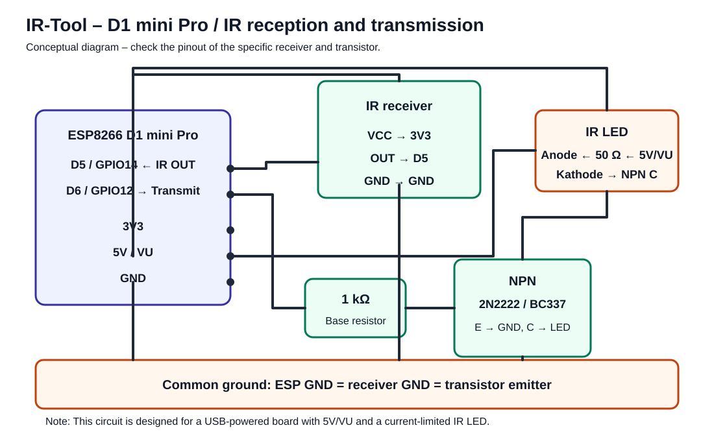

# IR-Tool

Complete ESP8266 project for recording, permanently storing, and transmitting infrared signals through a mobile web interface.

## Project status

The project is designed for a **LOLIN/WEMOS D1 mini Pro (ESP8266)**.

| Function | Implementation |
|---|---|
| IR reception | `D5` / GPIO14 |
| IR transmission | `D6` / GPIO12 through a transistor |
| Web interface | dedicated `ESP-IR` Wi-Fi network, `192.168.4.1` |
| Storage | LittleFS, 5 slots |
| Protocols | Samsung, Samsung36, Epson, raw fallback |
| Hold function | Signal is repeated for approximately 2 seconds during transmission |
| Operation | Large touch targets, suitable for small displays |

## Files

- [`esp_ir_webinterface.ino`](esp_ir_webinterface.ino) – firmware
- [`docs/WIRING.md`](docs/WIRING.md) – wiring and assembly
- [`docs/schematic.svg`](docs/schematic.svg) – schematic
- [`docs/TESTPLAN.md`](docs/TESTPLAN.md) – commissioning and functional test

## Required components

- ESP8266 D1 mini Pro
- 38 kHz IR receiver, such as VS1838B or TSOP38238
- 940 nm IR LED
- NPN transistor, such as 2N2222, BC337, or equivalent
- 1 kΩ resistor for the transistor base
- 50 Ω resistor for the IR LED (only with an IR LED and transistor rated for it)
- Breadboard and jumper wires
- USB data cable

The receiver must be compatible with 3.3 V. The pin order of IR receivers varies by manufacturer; check the datasheet before connecting it.

## Circuit



The IR LED is not driven directly by an ESP8266 GPIO. The GPIO only drives the transistor base. The LED is powered through a 50 Ω series resistor. At 5 V, this can produce approximately 70–75 mA of pulse current. This is only permitted if the LED datasheet and transistor support that pulse current. All GND connections must be common.

A detailed connection table is available in [`docs/WIRING.md`](docs/WIRING.md).

## Installation with the Arduino IDE

1. Install the ESP8266 board package.
2. Install the `IRremoteESP8266` library.
3. Open `esp_ir_webinterface.ino`.
4. Select the `LOLIN(WEMOS) D1 mini Pro` board. If it is not listed, use `LOLIN(WEMOS) D1 mini`.
5. Select the correct COM port.
6. Compile and upload the sketch.

The firmware uses LittleFS. If the installed ESP8266 core asks for a filesystem upload, select `LittleFS`.

## Operation

1. Connect to the **ESP-IR** Wi-Fi network.
2. Password: **12345678**.
3. Open `http://192.168.4.1` in a browser.
4. Select a storage slot.
5. Press **Record IR signal** and press a button on the remote control.
6. Check the protocol, frequency, and pulse count.
7. Press **Save signal permanently**.
8. **Send saved signal** repeats the signal for approximately two seconds, similar to holding down a button.

## Code settings

The most important settings are at the beginning of `esp_ir_webinterface.ino`:

| Constant | Default | Description |
|---|---:|---|
| `SEND_DURATION_MS` | `2000` | Transmission duration in milliseconds; `5000` gives approximately 5 seconds |
| `SEND_GAP_MS` | `35` | Delay between two IR frames in milliseconds |
| `SLOT_COUNT` | `5` | Number of storage slots; the web interface currently shows 5 buttons |
| `IR_RECEIVE_PIN` | `D5` | IR receiver input |
| `IR_SEND_PIN` | `D6` | Transistor driver output |
| `AP_SSID` | `ESP-IR` | Name of the Wi-Fi network created by the ESP |
| `AP_PASSWORD` | `12345678` | Wi-Fi password, at least 8 characters |

Example: change this line for a transmission duration of 10 seconds:

```cpp
const uint16_t SEND_DURATION_MS = 10000;
```

Then compile and upload the sketch again. The web interface also displays the transmission duration automatically from this value.

## Safety and limitations

- Never operate the IR LED without a series resistor.
- 50 Ω is not a generally safe standard value: for a typical 20 mA IR LED, it is too small and can destroy the LED.
- Size the current and transistor for a stronger IR driver according to the datasheets.
- Do not shine the LED directly into anyone's eyes.
- The ESP8266 creates its own Wi-Fi network; it does not connect to your home network automatically.
- Slot files from an older firmware version may become invalid after an update. Record the slots again in that case.

## Functional test

The complete procedure is available in [`docs/TESTPLAN.md`](docs/TESTPLAN.md). The test passes when a signal can be recorded, displayed with its data, stored in a slot, loaded again after a restart, and transmitted through the IR LED.
